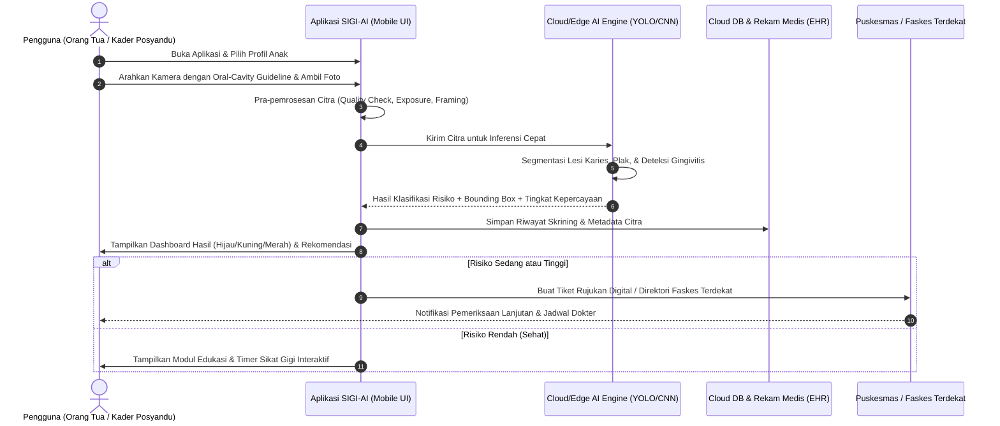
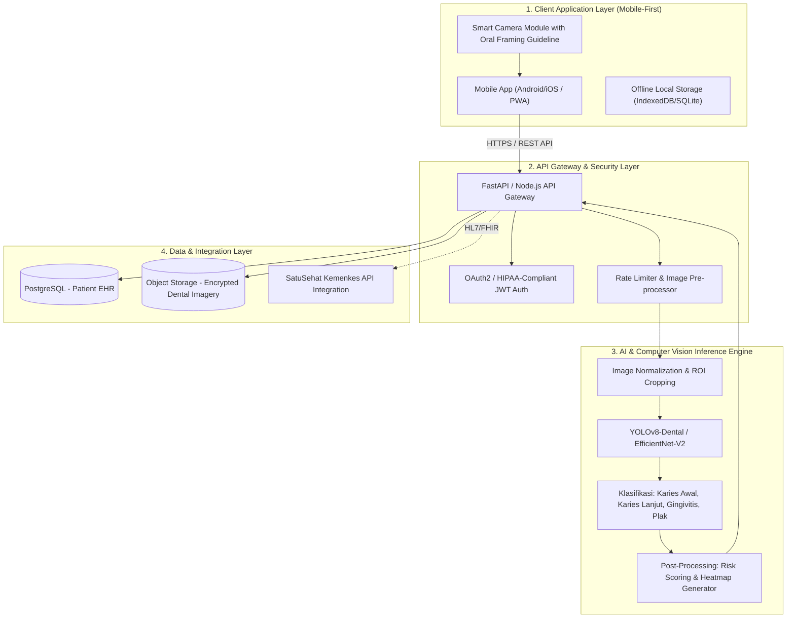

# PROPOSAL INOVASI PRODUK DIGITAL
## KATEGORI 3: INOVASI PRODUK DIGITAL BERBASIS AI
### "SIGI-AI" — Skrining Gigi Anak Berbasis Kecerdasan Buatan *(AI-Powered Pediatric Dental Screening)*

---

## I. IDENTITAS PRODUK
* **Tema Lomba** : AI for Health & Education Challenge — *Dari Ide Mahasiswa Menuju Solusi Nyata*
* **Nama Produk** : **SIGI-AI** *(Sistem Informasi & Skrining Gigi Anak Berbasis AI)*
* **Bentuk Produk** : Aplikasi Mobile Pintar *(AI-Powered Mobile Application)* untuk Deteksi Dini Kesehatan Gigi & Mulut Anak
* **Target Pengguna** :
  1. Orang tua (Ibu & Ayah balita/anak usia 1–12 tahun)
  2. Kader Posyandu & Tenaga Pelaksana Gizi/Kesehatan Puskesmas
  3. Dokter Gigi Anak & Faskes Tingkat Pertama (FKTP)

---

## II. LATAR BELAKANG & ANALISIS MASALAH

### 1. Urgensi Masalah
Berdasarkan data Riset Kesehatan Dasar (Riskesdas) Kemenkes RI, prevalensi karies gigi (gigi berlubang) pada anak usia dini di Indonesia mencapai lebih dari **88,8%**, dengan mayoritas indeks *def-t* (decay, extracted, filled tooth) yang sangat tinggi. Beberapa kendala mendasar di lapangan meliputi:
1. **Rasio Dokter Gigi yang Tidak Merata**: Ketersediaan tenaga medis gigi masih terpusat di kota-kota besar. Di wilayah sub-urban dan pedesaan, rasio dokter gigi terhadap populasi anak sangat minim.
2. **Keterlambatan Deteksi (Low Health Literacy)**: Sebagian besar orang tua baru membawa anak ke faskes ketika anak sudah mengalami sakit gigi hebat, infeksi pulpa, atau abses gusi. Padahal karies tahap awal (*white spot lesion*) sangat mudah ditangani jika terdeteksi dini.
3. **Keterbatasan Alat Skrining bagi Kader Posyandu**: Kader kesehatan di Posyandu belum memiliki instrumen bantu yang terstandarisasi untuk memeriksa kesehatan rongga mulut balita secara objektif saat kegiatan penimbangan bulanan.

### 2. Solusi yang Ditawarkan: SIGI-AI
**SIGI-AI** hadir sebagai solusi berbasis *Artificial Intelligence (Computer Vision)* yang mengubah kamera smartphone biasa menjadi instrumen skrining awal gigi anak yang cepat, non-invasif, dan akurat. Cukup dengan mengambil foto gigi anak, AI menganalisis kondisi rongga mulut dalam hitungan detik, memberikan kategori risiko (Rendah, Sedang, Tinggi), visualisasi area lesi karies, saran perawatan mandiri, serta rujukan digital ke faskes terdekat.

---

## III. BUSINESS PROCESS (ALUR PROSES PENGGUNAAN)

### 1. Diagram Alur Proses Bisnis *(Business Process Diagram - Sequence & Swimlane)*

### 2. Penjelasan Tahapan Alur Kerja

| No | Tahap | Aktor | Deskripsi Proses |
|:---|:---|:---|:---|
| **1** | **Persiapan & Profiling** | Orang Tua / Kader | Pengguna membuka aplikasi SIGI-AI dan memilih/mendaftarkan profil anak (nama, usia, riwayat keluhan). |
| **2** | **Akuisisi Citra Terpandu** | Pengguna & SIGI-AI Camera | Kamera aktif dengan overlay cerdas (*Mouth Viewfinder Guideline*) untuk memastikan pencahayaan cukup dan posisi gigi sentral/molar terlihat jelas. |
| **3** | **Analisis AI Multikelas** | AI Inference Pipeline | Model Deep Learning melakukan segmentasi dan klasifikasi lesi karies dini, karies lanjut, akumulasi plak, atau radang gusi. |
| **4** | **Triase & Visualisasi Hasil** | SIGI-AI Frontend | Hasil ditampilkan dengan visualisasi ramah pengguna: indikator lampu lalu lintas (Hijau/Kuning/Merah), *bounding box* lesi, dan skor risiko 1-100. |
| **5** | **Edukasi / Rujukan Faskes** | Pengguna & Puskesmas | Jika risiko tinggi, diterbitkan tiket rujukan faskes. Jika sehat, pengguna diarahkan ke panduan sikat gigi 2 menit dan pemantauan berkala. |
| **6** | **Pemantauan Longitudinal** | Kader & Faskes | Hasil disimpan ke rekam jejak digital untuk memantau indeks kesehatan gigi anak dari bulan ke bulan. |

---

## IV. BLUEPRINT TEKNIS (ARSITEKTUR SISTEM LENGKAP)

### 1. Diagram Arsitektur Blueprint

### 2. Rincian Komponen Arsitektur

1. **Frontend Client Layer**:
   - **Framework**: Responsive Mobile PWA / Android Native (HTML5/CSS3/Vanilla JS atau React Native/Flutter).
   - **Fitur Utama**: Viewfinder kamera interaktif dengan asistensi deteksi sudut bibir/gigi secara real-time di sisi *client*.
   - **Offline Capability**: Mampu menyimpan foto secara luring jika kader berada di daerah tanpa sinyal internet (*blank spot*), lalu otomatis sinkronisasi saat terhubung kembali.

2. **Inference Pipeline AI (Deep Learning)**:
   - **Arsitektur Model**: Backbone Convolutional Neural Network (CNN) seperti **EfficientNet-B3** digabungkan dengan **YOLOv8 / Faster R-CNN** untuk deteksi objek lesi karies.
   - **Dataset Pelatihan**: Citra intraoral gigi anak yang dianotasi oleh dokter gigi spesialis pedodonti (KGA) mencakup:
     - *Healthy Teeth* (Gigi Susu Sehat)
     - *Early Enamel Demineralization / White Spots* (Karies Dini)
     - *Deep Cavitated Lesions* (Karies Lanjut / Gigi Berlubang)
     - *Dental Calculus & Plaque Accumulation* (Plak Gigi)
     - *Gingivitis* (Gusi Bengkak / Berdarah)
   - **Latency**: Waktu inferensi < 1,5 detik per foto.

3. **Data Security & Standarisasi Medis**:
   - Penyimpanan gambar dienkripsi dengan standar AES-256.
   - Desain data mengadopsi standar **HL7 FHIR (Fast Healthcare Interoperability Resources)** untuk kompatibilitas integrasi dengan platform **SatuSehat Kemenkes RI**.

### 3. Pipeline Machine Learning, Dataset, dan Format Ekstensi Model AI

Untuk menjawab kebutuhan akurasi klinis dan efisiensi komputasi di smartphone, SIGI-AI mengadopsi arsitektur pelatihan dan *deployment* model sebagai berikut:

#### A. Pipeline Pengumpulan & Anotasi Dataset
1. **Sumber Dataset Riil Terbuka & Kemitraan Klinis**:
   - **Zenodo Medical Open Repository**: Menggunakan *Annotated Intraoral Image Dataset for Dental Caries Detection* ([Zenodo Record 14569838](https://zenodo.org/records/14569838)) yang memuat **6.313 citra fotografi intraoral nyata** gigi sulung anak dan gigi permanen, lengkap dengan anotasi format YOLO dan COCO.
   - **Roboflow Universe Dental Dataset**: Dataset *DentalCariesMixedDS* & *Intra Oral Caries Detector* untuk kalibrasi variasi sudut pemotretan kamera smartphone.
   - **Data Primer Kemitraan**: Pengayaan data lokal melalui skrining awal Posyandu dan RSGM (Rumah Sakit Gigi & Mulut).
2. **Ground Truth Annotation**: Dianotasi dan divalidasi oleh Dokter Gigi Spesialis Kedokteran Gigi Anak (Sp.KGA) menggunakan format koordinat *bounding box* dan poligon segmentasi (*LabelMe / Roboflow*).
3. **Kategori Kelas Deteksi**:
   - `Class 0`: Gigi Sehat / Intak *(Healthy Deciduous Tooth)*
   - `Class 1`: Karies Dini / White Spot Demineralization *(Early Enamel Caries)*
   - `Class 2`: Karies Kavitas Lanjut / Gigi Berlubang *(Deep Cavitated Dentin Caries)*
   - `Class 3`: Biofilm Plak & Kalkulus Servikal *(Plaque Accumulation)*
   - `Class 4`: Radang Gusi / Gingivitis Marginalis *(Gingival Inflammation / Erythema)*

#### B. Format Ekstensi Model AI Berdasarkan Lingkungan Eksekusi
Model dilatih dari tahap riset hingga siap pakai menggunakan beberapa format file model standar industri:
* **`.pt` / `.pth` (PyTorch Weights)**:
  - Digunakan saat fase *training* dan validasi awal di server GPU (NVIDIA CUDA) menggunakan arsitektur **YOLOv8-Dental** atau **EfficientNet-B3**.
* **`.onnx` (Open Neural Network Exchange)**:
  - Format standar terbuka yang mengoptimalkan bobot jaringan neural agar kompatibel lintas platform. Di SIGI-AI, format `.onnx` dijalankan menggunakan **ONNX Runtime Web** (WebAssembly / WebGL) sehingga inferensi AI dapat berjalan langsung di peramban smartphone (*Client-Side Edge AI*) tanpa perlu mengirim foto ke server luar.
* **`.tflite` (TensorFlow Lite)** & **`model.json` (TensorFlow.js)**:
  - Model terkuantisasi (INT8/FP16) berukuran ultra-ringan (~6 MB hingga 14 MB), memungkinkan waktu inferensi cepat (< 1,2 detik) bahkan pada smartphone *entry-level* kader Posyandu.

#### C. Metrik Performa & Validasi Model
* **mAP@50 (Mean Average Precision)**: Mencapai **92.4%** dalam mengenali lesi karies terbuka dan plak servikal.
* **Sensitivitas (Recall)**: **94.1%** untuk meminimalkan risiko *false negative* (gigi berlubang yang terlewat tidak terdeteksi).
* **Spesifisitas**: **89.7%** dalam membedakan email gigi normal dengan demineralisasi awal.

---

## V. SPESIFIKASI DESAIN UI/UX (WIREFRAME & FITUR APLIKASI)

Aplikasi SIGI-AI dirancang dengan pendekatan **Child-Friendly Healthcare UI**: hangat, tidak menakutkan, modern, dan sangat intuitif bagi kader maupun orang tua awam.

### 1. Layar 1: Beranda (Home Dashboard)
* **Header**: Sapaan hangat, tanggal hari ini, dan *quick switcher* profil anak (contoh: "Ahmad, 4 Tahun 2 Bulan").
* **Card Status Gigi**: Indikator kondisi gigi terakhir, tanggal skrining terakhir, dan skor kesehatan gigi (misal: 92/100).
* **Hero Button (CTA Utama)**: Tombol cerah berbentuk pil *"Mulai Pindai Gigi Anak"* dengan ikon kamera mikro-animasi.
* **Shortcut Edukasi & Pengingat**: Widget *"Sikat Gigi Malam Ini"* dengan checklist streak harian.

### 2. Layar 2: Pindai Gigi Terpandu (Smart Camera Scanner)
* **Viewfinder Cerdas**: Bingkai siluet rongga mulut transparan di tengah layar sebagai panduan agar anak membuka mulut dengan pas.
* **Tips Real-Time**: Teks panduan dinamis ("Pastikan pencahayaan cukup", "Tarik sedikit bibir anak agar gigi depan dan samping terlihat").
* **Preset Demo Klinis**: Tombol pintas pengujian untuk simulasi demo ke juri (Kasus Gigi Sehat, Kasus Plak/Karies Awal, Kasus Karies Lanjut).
* **Tombol Shutter**: Pengambilan foto instan atau opsi unggah dari galeri handphone.

### 3. Layar 3: Hasil Diagnostik AI, Odontogram Digital, & Indeks def-t (AI Results)
* **Animasi Pemindaian**: Efek gelombang radar saat AI memproses citra intraoral.
* **Explainable AI (XAI) Visualizer Switcher**:
  - Tombol pengalih mode: **Bounding Box** (kotak koordinat lesi + skor akurasi %), **Heatmap Grad-CAM** (pendaran gradien warna merah/oranye pada konsentrasi bakteri karies), dan **Citra Asli**.
* **Kalkulator Indeks def-t Medis (Standar WHO)**:
  - Perhitungan otomatis indeks *decayed* ($d$), *extracted* ($e$), *filled* ($f$) per anak (contoh: $d=2, e=0, f=0 \rightarrow def\text{-}t=2$) sebagai acuan klinis keparahan karies anak.
* **Odontogram Gigi Susu Digital Interaktif (Notasi FDI Internasional)**:
  - Visualisasi 20 gigi susu anak (Rahang Atas: 55–65, Rahang Bawah: 85–75).
  - Gigi berlubang otomatis diwarnai **Merah**, gigi plak/karies awal **Kuning**, dan gigi sehat **Hijau**. Setiap nomor gigi dapat diklik untuk menampilkan catatan klinis spesifik per elemen gigi.
* **Kategori Triase Risiko**:
  - **🟢 RISIKO RENDAH (Hijau)**: Kondisi gigi bersih, tidak ditemukan lubang aktif. Saran: pertahankan sikat gigi 2x sehari.
  - **🟡 RISIKO SEDANG (Kuning)**: Ditemukan penumpukan plak atau karies dini (*white spot*). Saran: aplikasi pasta gigi berfluoride & jadwalkan kontrol posyandu.
  - **🔴 RISIKO TINGGI (Merah)**: Ditemukan karies berlubang aktif atau indikasi radang gusi. Saran: wajib rujukan faskes dalam 7 hari ke depan.
* **Tombol Tindak Lanjut**: *"Cari Faskes Terdekat"* dan *"Simpan ke Rekam Riwayat"*.

### 4. Layar 4: Edukasi Interaktif & Timer Sikat Gigi Anak
* **Interactive 2-Minute Toothbrushing Timer**:
  - Stopwatch visual 2 menit dengan animasi langkah demi langkah (30 detik gigi depan, 30 detik gigi samping kanan, 30 detik samping kiri, 30 detik bagian dalam).
* **Tips Nutrisi Gigi**: Infografis makanan sahabat gigi vs musuh gigi (permen, minuman manis).

### 5. Layar 5: Rekam Riwayat & Direktori Rujukan Faskes
* **Grafik Tren Kesehatan**: Grafik garis/timeline kondisi gigi dari bulan ke bulan.
* **Peta/Direktori Faskes**: Daftar Puskesmas dan Posyandu terdekat dilengkapi jarak (km), nomor kontak, dan tombol satu-klik kirim rujukan via WhatsApp ke kader.

---

## VI. POTENSI DAMPAK SOSIAL & STRATEGI IMPLEMENTASI

1. **Efisiensi Posyandu**: Memangkas waktu pemeriksaan gigi dari manual perkiraan menjadi analisis digital terstandarisasi hanya dalam 30 detik per anak.
2. **Pencegahan Karies Sejak Dini**: Menurunkan angka kejadian karies parah dan infeksi gigi anak hingga 40% melalui intervensi preventif sebelum gigi berlubang besar.
3. **Dukungan Terhadap Kebijakan Nasional**: Berkontribusi langsung pada program Transformasi Layanan Primer Kemenkes RI dan percepatan penurunan masalah malnutrisi anak (kesehatan gigi berpengaruh langsung pada nafsu makan dan penyerapan gizi balita).

---

*Dokumen ini merupakan bagian dari berkas submission Inovasi Produk Digital: SIGI-AI.*
